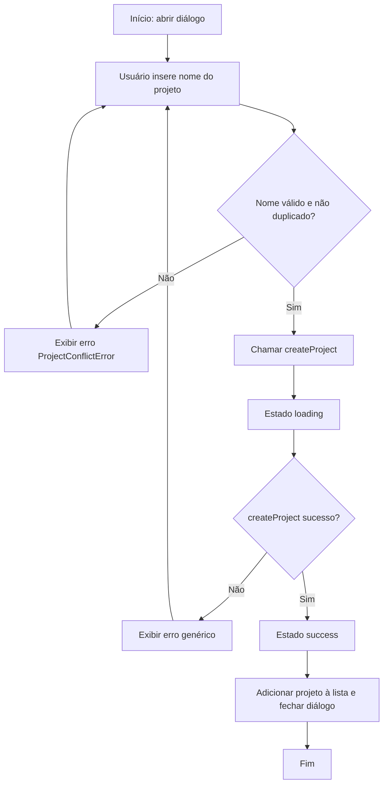
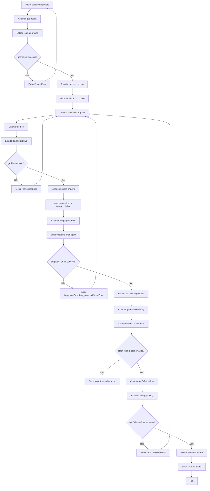

# User Flows & Interaction Diagrams — Linguistic Isolation Desktop Tool

## 1. User Personas & Actors  
> **[ENTRADA HUMANA NECESSÁRIA — não gerado a partir do código]** **[INFERIDO POR IA — REQUER VALIDAÇÃO HUMANA]**  
> Premissas adotadas: as personas foram extraídas do BRD (Seção 3) e consideradas como atores canônicos para este documento, já que não há artefato de glossário disponível.

| Ator | Papel | Objetivos Principais | Permissões |
| :--- | :--- | :--- | :--- |
| Desenvolvedor de Linguagens | Engenheiro que cria ou mantém analisadores, linters ou formatadores para diversas linguagens. | Isolar projetos para evitar interferência entre gramáticas e dependências; obter detecção precisa de linguagem e parsing confiável. | Criar, ler, atualizar e excluir projetos; salvar e excluir arquivos; invocar detecção de linguagem e parsing; visualizar mensagens de erro e sucesso. |
| Arquiteto de Sistemas | Responsável por padrões de ferramentas, segurança e conformidade. | Garantir controle de acesso a arquivos, limites de armazenamento e auditoria de operações. | Definir limites de tamanho (`setMaxSizeMB`), visualizar estatísticas de cache e memória, acionar evicção (`evictIfNeeded`), revisar logs de `handleWorkerDeath` e `SecurityError`. |
| Gerente de Produto | Líder que define roadmap e métricas de adoção. | Obter visibilidade de uso através de métricas de criação de projetos e detecção de linguagem. | Visualizar dashboards de projetos ativos por usuário, taxa de acerto de `languageForFile`, taxa de `QuotaExceededError` e `FileAccessError`. |

## 2. Core User Flows  

### Flow 1: Criar Novo Projeto  
* **Gatilho:** Usuário clica em “Novo Projeto” na barra de ferramentas ou usa o atalho Ctrl+Shift+N.  
* **Ator:** Desenvolvedor de Linguagens (ou qualquer ator que deseje iniciar um trabalho).  
* **Pré-condições:** Aplicação está em estado ocioso; nenhum projeto com o mesmo nome existe no armazenamento local.  
* **Resultado esperado:** Projeto criado com estrutura de diretórios vazia, cache inicializado e notificação de sucesso exibida.

* **Passos:**  
  1. Usuário abre o diálogo de criação de projeto e insere um nome.  
  2. Sistema chama `createProject` (BR‑01) passando o nome.  
  3. Enquanto a operação está em curso, o UI exibe estado **loading**.  
  4. Se o nome já existir, `createProject` lança `ProjectConflictError`; o UI exibe estado **error** com mensagem apropriada.  
  5. Se a criação for bem‑sucedida, o UI exibe estado **success**, lista o novo projeto na barra lateral e limpa o diálogo.  
  6. O usuário pode então selecionar o projeto para começar a trabalhar.



* **Estados de UI cobertos:** loading, empty (diálogo vazio antes de inserir nome), error (ProjectConflictError ou outro), success (projeto criado), disabled (botão de criação desativado enquanto loading).  
* **Métricas instrumentadas neste fluxo:** taxa de criação de projetos por semana, tempo médio entre abertura do diálogo e confirmação de sucesso, percentual de tentativas que resultam em `ProjectConflictError`.

---

### Flow 2: Abrir Projeto, Editar Arquivo e Obter Árvore de Sintaxe  
* **Gatilho:** Usuário seleciona um projeto existente na barra lateral ou usa o menu “Abrir Projeto”.  
* **Ator:** Desenvolvedor de Linguagens ou Arquiteto de Sistemas (para inspeção).  
* **Pré-condições:** Pelo menos um projeto existe no armazenamento local; o projeto selecionado não está atualmente em estado de erro.  
* **Resultado esperado:** O projeto é carregado, o arquivo selecionado é aberto no Monaco Editor, a linguagem é detectada, a árvore sintática é gerada (ou recuperada do cache) e exibida em visualização de AST (se disponível).

* **Passos:**  
  1. Usuário clica no nome do projeto → sistema chama `getProject` (BR‑02).  
  2. Enquanto o projeto é carregado, o UI exibe estado **loading** na área de conteúdo.  
  3. Se o projeto não for encontrado, `getProject` retorna `ProjectError`; UI exibe estado **error** com mensagem.  
  4. Projeto carregado com sucesso → UI exibe estado **success**, lista de arquivos do projeto aparece.  
  5. Usuário seleciona um arquivo → sistema chama `getFile` (BR‑06).  
  6. Enquanto o arquivo é lido, estado **loading** no editor.  
  7. Se o arquivo não existir ou houver problema de permissão, `FileAccessError` é lançado; UI exibe estado **error**.  
  8. Arquivo carregado → conteúdo colocado no Monaco Editor; estado **success** do editor.  
  9. Sistema chama `languageForFile` (BR‑04) para detectar a linguagem do arquivo.  
 10. Enquanto a detecção ocorre, indicador de linguagem mostra **loading**.  
 11. Se a linguagem não for suportada, `LanguageError` ou `LanguageNotFoundError` é lançado; UI exibe estado **error** com aviso.  
 12. Linguagem detectada com sucesso → UI exibe estado **success** (ex: badge com nome da linguagem).  
 13. Sistema chama `generateHashKey` sobre o conteúdo e compara com hash armazenado (BR‑08).  
 14. Se hash diferir ou não houver entrada em cache, chama `getOrParseTree` (BR‑04, BR‑08) para gerar a árvore sintática via Tree‑sitter.  
 15. Enquanto o parsing ocorre, UI exibe estado **loading** na visualização de AST.  
 16. Se o parsing falhar, `MCPTreeSitterError` pode ser lançado; UI exibe estado **error**.  
 17. Parsing bem‑sucedido → árvore sintática exibida; UI exibe estado **success**.  
 18. O conteúdo do arquivo pode ser editado; a cada salvamento (`saveFile`), o hash é recalculado e o cache é atualizado conforme BR‑05 e BR‑08.



* **Estados de UI cobertos:** loading (projeto, arquivo, linguagem, parsing), empty (lista de arquivos vazia quando nenhum arquivo foi adicionado), error (ProjectError, FileAccessError, LanguageError/LanguageNotFoundError, MCPTreeSitterError), success (projeto carregado, arquivo aberto, linguagem detectada, AST exibida), disabled (botões de salvar/parse desativados enquanto loading).  
* **Métricas instrumentadas neste fluxo:** taxa de acerto da função `languageForFile`, tempo médio de detecção de linguagem, percentual de erros de parsing não tratados (`MCPTreeSitterError`), tempo médio entre abertura de arquivo e exibição da AST.

---

### Flow 3: Tratamento de Erro de Quota Excedida (Limite de Armazenamento)  
* **Gatilho:** Usuário tenta salvar um arquivo ou lote de arquivos que faria o tamanho total do projeto ultrapassar o limite definido por `setMaxSizeMB`.  
* **Ator:** Desenvolvedor de Linguagens (ou qualquer ator que esteja editando).  
* **Pré-condições:** Limite de armazenamento já configurado via `setMaxSizeMB`; o projeto atual está próximo desse limite.  
* **Resultado esperado:** Operação de salvamento é bloqueada, o UI exibe estado **error** com mensagem clara sobre quota excedida e oferece opções de arquivamento ou exclusão de projetos antigos.

* **Passos:**  
  1. Usuário edita um arquivo e aciona “Salvar” (Ctrl+S) ou “Salvar Tudo”.  
  2. Sistema chama `saveFile` ou `saveFilesBatch` (BR‑06).  
  3. Enquanto a operação está em curso, o UI exibe estado **loading** no botão de salvar.  
  4. Antes de gravar, o sistema verifica o tamanho atual contra o limite (implícito em `QuotaExceededError` conforme BR‑10).  
  5. Se o limite seria ultrapassado, `QuotaExceededError` é lançado; UI exibe estado **error** com mensagem “Limite de armazenamento excedido. Libere espaço ou exclua projetos antigos.”  
  6. O usuário pode então abrir o gerenciador de projetos, ver o tamanho de cada projeto e escolher excluir ou arquivar um projeto.  
  7. Após liberação de espaço, o usuário repete a tentativa de salvamento; agora o limite não é mais ultrapassado.  
  8. `saveFile`/`saveFilesBatch` conclui com sucesso; UI exibe estado **success** (toast “Arquivo salvo”) e o botão de salvar retorna ao estado padrão.  

```mermaid
graph TD
    A[Início: usuário tenta salvar] --> B[Chamar saveFile/saveFilesBatch]
    B --> C[Estado loading no botão salvar]
    C --> D{Verificar quota antes de gravar?}
    D -- Sim --> E[Chamar verificação implícita]
    E --> F{Quota seria excedida?}
    F -- Não --> G[Proceder com gravação]
    G --> H[Estado success salvamento]
    H --> I[Exibir toast de sucesso]
    I --> J[Fim]
    F -- Sim --> K[Lançar QuotaExceededError]
    K --> L[Estado error com mensagem de quota]
    L --> M[Usuário abre gerenciador de projetos]
    M --> N[Visualizar tamanho dos projetos]
    N --> O[Usuário exclui ou arquiva projeto(s)]
    O --> P[Espaço liberado]
    P --> A
```

* **Estados de UI cobertos:** loading (botão de salvar), empty (nenhum projeto disponível para exclusão – caso raro), error (QuotaExceededError), success (salvo com sucesso), disabled (botão de salvar desativado enquanto loading ou quando quota excedida).  
* **Métricas instrumentadas neste fluxo:** percentual de operações de salvamento que resultam em `QuotaExceededError`, tempo médio entre detecção de quota excedida e liberação de espaço pelo usuário.

## 3. Edge Cases & Error Flows  

| Cenário | Tratamento na UI | Mensagem exibida |
| :--- | :--- | :--- |
| Tentativa de abrir um projeto que foi excluído por outro processo (condição de corrida) | UI exibe estado **error** e oferece recarregar a lista de projetos | “Projeto não encontrado. Pode ter sido excluído por outro processo. Clique em recarregar.” |
| Falha inesperada do sidecar Express (worker death) durante uma operação de parsing | UI exibe estado **error** geral, tenta reiniciar o worker via `handleWorkerDeath` (BR‑07) e mostra indicador de reconexão | “Worker indisponível. Tentando reiniciar…” |
| Usuário tenta colar conteúdo muito grande no Monaco Editor (> 5 MB) | Editor fica em estado **loading** enquanto verifica tamanho; se ultrapassar limite interno, exibe estado **error** | “Conteúdo excede o tamanho máximo permitido para colagem.” |
| Rede de acesso a disco lenta (ex: antivírus escaneando arquivo) | Operações de arquivo exibem estado **loading** prolongado; após timeout, exibe estado **error** com sugestão de tentar novamente | “Leitura/gravação do arquivo está demorando mais que o esperado. Verifique seu antivírus ou tente novamente.” |
| Usuário tenta mudar a linguagem do arquivo manualmente via seletor, mas a linguagem não possui gramática Tree‑sitter | Seletor mostra estado **disabled** para opções inválidas; ao selecionar, exibe estado **error** com mensagem | “Gramática Tree‑sitter não disponível para essa linguagem. Selecione outra linguagem suportada.” |

## 4. Cross-Flow Dependencies  

* O Flow 2 (Abrir e Editar Arquivo) só pode ser iniciado após a conclusão bem‑sucedida do Flow 1 (Criar Novo Projeto) ou após o projeto já existir no armazenamento (pré‑condição de existência de projeto).  
* O Flow 3 (Tratamento de Quota Excedida) pode ser acionado a partir de qualquer passo que envolva gravação de arquivos nos Flows 1 e 2; portanto, depende da execução correta dos métodos `saveFile`/`saveFilesBatch`.  
* Métricas de detecção de linguagem (Flow 2) alimentam o dashboard do Gerente de Produto (Flow 1) para calcular a North Star Metric (projetos ativos por usuário por mês).  

## 5. Acessibilidade nos Fluxos  

* **Navegação por teclado:**  
  - Todos os diálogos (criação de projeto, seleção de arquivo, configurações de quota) seguem a ordem tab lógica: foco inicia no primeiro campo de entrada, passa pelos botões de ação (Cancelar, Salvar, Criar) e retorna ao elemento que abriu o diálogo.  
  - Atalhos globais: `Ctrl+Shift+N` (Novo Projeto), `Ctrl+O` (Abrir Projeto), `Ctrl+S` (Salvar), `Ctrl+Shift+S` (Salvar Tudo), `Ctrl+Shift+P` (Abrir paleta de comandos).  
  - Botões de estado (loading, success, error) são anunciados como `button` com `aria-live="polite"` para que leitores de tela comuniquem mudanças de estado sem interromper a digitação.  

* **Leitores de tela:**  
  - Campos de entrada possuem rótulos associados via `<label>` ou `aria-label` (ex: “Nome do projeto”, “Selecionar arquivo”).  
  - Mensagens de erro e sucesso são inseridas em um container com `role="alert"` para serem anunciadas imediatamente.  
  - A visualização de AST, quando presente, possui descrição resumida via `aria-describedby` indicando o número de nós e a linguagem detectada; usuários podem navegar por árvore usando teclas de seta se o componente for implementado com foco gerenciado.  
  - O Monaco Editor já fornece suporte a leitores de tela; garantimos que o `tabIndex` do editor seja `-1` quando não estiver em foco e que o foco retorne ao editor após fechar diálogos.  

## 6. Referências  

* **Wireframes/Protótipos:** [Link para protótipo Figma – a ser preenchido pela equipe de design]  
* **Use Cases relacionados:** *[OMITIDO – artefato de use‑cases não disponível como fonte]*