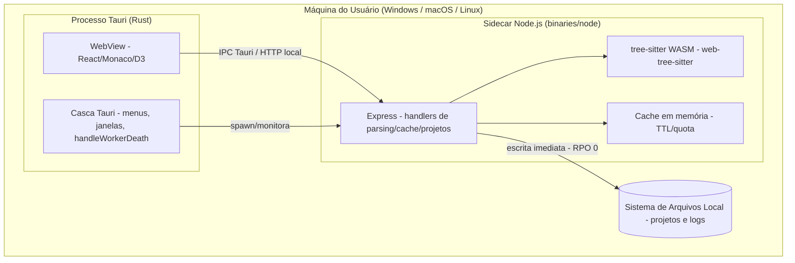

# System Architecture Document (SAD) — Linguistic Isolation Desktop Tool

> **Versão:** 1.0 · **Owner:** Engenharia/Arquitetura · **Status:** Draft
> **ADRs relacionadas:** Nenhuma ADR formalizada até o momento — decisões arquiteturais estão registradas neste documento e nos NFRs.

## 1. Overview & Goals

O **Linguistic Isolation Desktop Tool** é uma aplicação desktop auto-contida para análise/parsing de código-fonte, construída sobre a casca **Tauri (Rust)** com um **sidecar Node.js/Express** responsável pela lógica de parsing via **tree-sitter (WASM)**. A interface é uma SPA **React 18** com editor **Monaco** e visualizações em **D3/Recharts**.

Objetivos arquiteturais principais (derivados dos NFRs):

* **Baixa latência local:** chamadas entre a camada Tauri e o sidecar Express com p95 ≤ 200 ms e p99 ≤ 500 ms (NFR-P01).
* **Execução desktop monolítica:** sem dependência de nuvem, sem escalabilidade horizontal (NFR-S02, NFR-PO02); custo de infraestrutura por usuário próximo de zero (NFR-CO01).
* **Resiliência do sidecar:** recuperação automática em ≤ 5 s após falha do processo Node.js, via `handleWorkerDeath` (NFR-A02), mantendo a camada Tauri responsiva (NFR-A04).
* **Eficiência de recursos:** ≤ 300 MB de memória por instância com até 50 projetos abertos (NFR-S03), apoiada por cache com TTL/evicção e hash de conteúdo para evitar re-parsing (NFR-P02, BR-08).
* **Durabilidade imediata:** RPO = 0 — alterações gravadas no sistema de arquivos local antes de retornar sucesso (NFR-A03).

## 2. Tech Stack Justification

| Camada | Tecnologia Escolhida | Alternativas Consideradas | Justificativa Resumida |
| :--- | :--- | :--- | :--- |
| Language/Runtime | Node.js + TypeScript (tsx, TypeScript 5.7) | Não registradas | Runtime único para front-end e sidecar; tipagem estática ponta a ponta; suporte nativo a WASM para o tree-sitter. |
| Framework Web/Servidor | Express 4 (com `cors`) | Não registradas | Servidor HTTP leve embutido como sidecar; superfície mínima, adequada a IPC local de baixa latência (NFR-P01/P03). |
| Engine de Banco de Dados | **Nenhum motor de banco detectado** — persistência via sistema de arquivos local | Não registradas | Não há dependência de banco nas `package.json`/`Cargo.toml`; o NFR-A03 (RPO = 0) é atendido por escrita imediata em disco. **Qualquer motor de banco futuro é [INFERIDO POR IA — REQUER VALIDAÇÃO HUMANA].** |
| ORM / Query Builder | **Nenhum** (sem ORM detectado) | Não registradas | Coerente com a ausência de banco de dados; acesso a dados é feito via sistema de arquivos. |
| Mensageria/Fila | **Nenhuma** — comunicação síncrona via IPC Tauri / HTTP local | Não registradas | Topologia desktop monolítica não requer filas; throughput alvo de 30 req/s (NFR-P03) é atendido por chamadas diretas. |
| Cache | Cache em memória no processo Node.js (get/set/evict com TTL, `getMemoryStats`, `setMaxSizeMB`) | Não registradas | Latência ≤ 100 ms (NFR-P02) e controle de quota de memória (NFR-S03, BR-10) sem infraestrutura externa. |
| Casca Desktop | Tauri 2 (Rust) com sidecar `binaries/node` | Não registradas | Binário desktop auto-contido e multiplataforma (NFR-PO01); Rust restrito à casca (única dependência extra: `getrandom`). |
| Front-end | React 18 + Vite 6 + Tailwind CSS 4 + Monaco Editor + D3/Recharts + lucide-react | Não registradas | Editor de código rico (Monaco) e visualização de árvores/métricas de parsing (D3, Recharts). |
| Parsing | web-tree-sitter 0.22.6 + tree-sitter-wasms 0.1.13 | Não registradas | Gramáticas tree-sitter compiladas para WASM, executáveis no Node.js sem toolchains nativos por linguagem. |
| Infraestrutura/Cloud | **Nenhuma** — aplicação desktop auto-contida (NFR-PO02) | Não registradas | Custo por usuário ≈ zero (NFR-CO01); distribuição como binário desktop. |

## 3. High-Level Architecture

A aplicação é um **processo desktop único** composto por três elementos em execução na máquina do usuário:

1. **Casca Tauri (Rust):** janela nativa, menus, ciclo de vida da aplicação e orquestração do sidecar (incluindo `handleWorkerDeath` para reinício automático — NFR-A02).
2. **Front-end React (WebView):** UI servida dentro da WebView do Tauri; comunica-se com o sidecar para operações de parsing, cache e arquivos.
3. **Sidecar Node.js/Express:** processo filho (`binaries/node`) que hospeda os handlers de parsing (tree-sitter WASM), o cache em memória e as operações de arquivo de projetos.

O diagrama de containers (C4) é mantido em [[uml-diagrams]] — não duplicado aqui.

### Componentes

| Componente | Responsabilidade | Tecnologia | Escala Independente? |
| :--- | :--- | :--- | :--- |
| Casca Desktop (Tauri) | Janela, menus, spawn/monitoramento do sidecar, recuperação de falhas (`handleWorkerDeath`) | Tauri 2 (Rust) | Não — processo único por instância |
| UI (WebView) | Editor de código, visualizações de parsing, diálogos de projeto (WCAG 2.1 AA — NFR-U01) | React 18, Monaco, D3, Recharts, Tailwind | Não — embutida na WebView |
| Sidecar API | Endpoints/handlers de parsing, cache, CRUD de projetos e arquivos | Node.js + Express 4 | Não — um sidecar por instância desktop (NFR-S02) |
| Motor de Parsing | Detecção de linguagem (BR-04), parse e reutilização de árvores (`getOrParseTree`) com hash de conteúdo (BR-08) | web-tree-sitter + tree-sitter-wasms (WASM) | Não — in-process no sidecar |
| Cache em Memória | get/set/evict com TTL, quota (`setMaxSizeMB`), estatísticas (`getMemoryStats`) | TypeScript (in-process) | Não |
| Persistência de Projetos | Criação/edição/exclusão de projetos e arquivos com escrita imediata (RPO = 0) | Sistema de arquivos local via Node.js | Não |

> **Nota de honestidade:** a varredura determinística não detectou rotas/IPC/handlers concretos no código. Os nomes de operações acima (`getOrParseTree`, `handleWorkerDeath`, `deleteProject`, `saveFile`, `setMaxSizeMB`, `getMemoryStats`) derivam dos NFRs/BRD e devem ser confirmados contra o código-fonte.

## 4. Architectural Style & Patterns

* **Estilo:** Monolito desktop modular — um único binário Tauri contendo UI + sidecar Node.js, sem distribuição em rede (NFR-S02).
* **Padrões aplicados:**
  * **Sidecar pattern:** lógica pesada (parsing WASM) isolada em processo filho, protegendo a responsividade da casca Tauri (NFR-A04).
  * **Cache-aside com TTL e evicção:** parsing sob demanda com invalidação por hash de conteúdo (BR-08) e quota de memória (BR-10).
  * **Supervisão/restart:** `handleWorkerDeath` como estratégia de recuperação do processo filho (NFR-A02).
  * **Serialização de erros descritiva (BR-09):** erros tipados (ex: `FileAccessError`, `QuotaExceededError`) propagados à UI sem vazar informações sensíveis (NFR-SEC03).
* **Comunicação entre componentes:** Síncrona — IPC Tauri e/ou HTTP local entre WebView e sidecar Express, **não exposta a interfaces de rede externas** (NFR-SEC02). Não há comunicação assíncrona por eventos/filas.

## 5. Data Modeling

**Não há motor de banco de dados no projeto** — nenhuma dependência de banco ou ORM foi detectada, e nenhuma tabela foi identificada. A persistência é feita **diretamente no sistema de arquivos local** (projetos, arquivos-fonte e metadados), com escrita síncrona antes do retorno ao chamador (NFR-A03, RPO = 0).

* **Modelo conceitual:** a definir em [[db-domain-model]] — entidades esperadas incluem Projeto, Arquivo e Árvore de Parsing cacheada. **[INFERIDO POR IA — REQUER VALIDAÇÃO HUMANA]** — premissa: os requisitos BR-01 a BR-10 mencionam projetos, arquivos e cache, mas nenhum schema foi detectado no código.
* **Estratégia de particionamento/sharding:** Não aplicável — dados locais por usuário, isolados por instalação desktop.
* **Estratégia de migração de schema:** Não aplicável no estado atual (sem banco). Se um motor de banco for introduzido futuramente, ver [[db-migration-spec]]. **[INFERIDO POR IA — REQUER VALIDAÇÃO HUMANA]**
* **Compliance de dados:** exclusão completa de arquivos e metadados de um projeto em `deleteProject` (direito ao esquecimento — NFR-C01); retenção de logs de auditoria por 12 meses (NFR-C02).

## 6. Integration Boundaries & APIs

| Integração | Tipo | Direção | Contrato | Criticidade |
| :--- | :--- | :--- | :--- | :--- |
| WebView ↔ Sidecar Express | IPC Tauri / HTTP local (loopback) | Bidirecional | OpenAPI (YAML) versionado junto ao código (NFR-M03) — **a definir** | Alta |
| Sidecar ↔ Sistema de arquivos local | FS API (Node.js) | Outbound | Erros tipados (`FileAccessError` — BR-06) | Alta |
| Sidecar ↔ Gramáticas tree-sitter WASM | In-process (WASM) | Interno | API web-tree-sitter | Alta |
| Serviços externos / nuvem | **Nenhum** | — | — | — |

Não há integrações externas detectadas nem previstas (NFR-PO02). Tokens para serviços externos futuros, se surgirem, seguem rotação de 90 dias via variáveis de ambiente do processo Node.js (NFR-SEC04).

## 7. Scalability & Performance Strategy

* **Estratégia de escala:** **Nenhuma escala horizontal** (NFR-S02). Crescimento de carga é atendido por novas instâncias desktop por usuário. Verticalmente, o limite é a máquina host: ≤ 300 MB de RAM por instância com 50 projetos ativos (NFR-S03).
* **Metas de performance:** IPC p95 ≤ 200 ms / p99 ≤ 500 ms (NFR-P01); cache ≤ 100 ms por operação (NFR-P02); ≥ 30 req/s sem degradação > 10 % no p95 (NFR-P03). Medição via scripts de carga locais (ex: wrk/artillery) **[INFERIDO POR IA — REQUER VALIDAÇÃO HUMANA]**.
* **Pontos de gargalo conhecidos:**
  * Parsing de arquivos grandes em WASM (CPU-bound, single-threaded por natureza do runtime) — mitigado pelo cache por hash (BR-08).
  * Concorrência de I/O de disco em operações de projeto — mitigada por escrita imediata e erros tipados (BR-06).
  * Pressão de memória do cache com 50 projetos — mitigada por quota (`setMaxSizeMB`) e evicção por TTL (BR-05, BR-10).
* **Estratégia de cache:** camada única em memória no sidecar; invalidação por hash de conteúdo (evita re-parsing) + TTL + evicção sob quota; estatísticas expostas por `getMemoryStats`.

## 8. Reliability & Fault Tolerance

* **Single points of failure identificados:** o **processo Node.js sidecar** é o único SPOF (NFR-A04). A casca Tauri permanece responsiva durante sua indisponibilidade.
* **Estratégias de resiliência:**
  * **Restart automático do sidecar** via `handleWorkerDeath`, com RTO ≤ 5 s (NFR-A02).
  * **Durabilidade síncrona:** escrita em disco antes de retornar sucesso — RPO = 0 (NFR-A03).
  * **Erros tipados e serializados** (BR-02, BR-09) para falhas previsíveis na UI.
  * **Dispose de recursos** ao excluir projetos (BR-03), evitando vazamento de memória/handles.
  * Retry com backoff, circuit breaker e bulkhead **não são aplicáveis** ao enlace local síncrono atual; introduzi-los seria **[INFERIDO POR IA — REQUER VALIDAÇÃO HUMANA]**.
* **Estratégia multi-região/multi-AZ:** Não aplicável — aplicação desktop local sem infraestrutura distribuída.
* **Meta de disponibilidade:** ≥ 99 %/mês considerando apenas falhas do próprio aplicativo (NFR-A01).

## 9. Security Architecture

* **Boundary de rede:** o sidecar Express **não escuta em interfaces externas**; o enlace WebView ↔ sidecar é interno à máquina (IPC/Tauri), dispensando TLS (NFR-SEC02). Não há VPC, subnets ou perímetro de rede — o boundary é o próprio host do usuário.
* **Proteção em repouso:** delegada à criptografia de disco do SO (BitLocker, FileVault, LUKS) — nenhuma biblioteca de criptografia adicional (NFR-SEC01).
* **Hardening da aplicação:** diretrizes OWASP Top 10 para desktop — validação de entrada, prevenção de path traversal e de execução arbitrária de código nos handlers de arquivo (NFR-SEC03); serialização de erros sem vazamento de dados sensíveis (BR-09).
* **Segredos:** nenhum segredo definido atualmente; futuros tokens seguem rotação de 90 dias via variáveis de ambiente do processo Node.js (NFR-SEC04).
* **Referência:** ver security-policies.md (a produzir).

## 10. Observability Architecture

**Nenhuma biblioteca de observabilidade (logging, tracing, métricas, APM) foi detectada nas dependências do projeto.** Todos os itens abaixo são **metas a implementar**, conforme os NFRs — nada descrito aqui existe hoje no código.

* **Logging centralizado:** **[INFERIDO POR IA — REQUER VALIDAÇÃO HUMANA]** — meta: logs estruturados JSON (info/warn/error) com timestamp, nível, módulo e mensagem, em arquivo local com rotação por tamanho (~10 MB) e retenção de 7 dias (NFR-O01). Premissa: implementação com recursos nativos do Node.js, dado que nenhuma biblioteca de logging está nas dependências.
* **Métricas:** **[INFERIDO POR IA — REQUER VALIDAÇÃO HUMANA]** — meta: endpoint `/metrics` no sidecar Express em formato Prometheus (contagem de chamadas IPC, latência p95/p99, memória, taxa de erros) (NFR-O02). Premissa: exposição restrita a loopback, coerente com NFR-SEC02.
* **Tracing distribuído:** **[INFERIDO POR IA — REQUER VALIDAÇÃO HUMANA]** — meta: span-ID/trace-ID propagados por headers personalizados nas chamadas críticas (`parse`, `getOrParseTree`, `saveFile`), persistidos nos arquivos de log (NFR-O03).
* **Alertas:** **[INFERIDO POR IA — REQUER VALIDAÇÃO HUMANA]** — meta: latência p95 > 250 ms, taxa de erro > 1 %, memória > 80 % da quota (NFR-O04). O mecanismo de entrega de alertas em um app desktop local precisa ser definido.

## 11. Deployment Topology

Topologia **real**: um único binário desktop por usuário, executando inteiramente na máquina local. **Não há load balancers, réplicas, clusters, regiões ou qualquer infraestrutura de nuvem.**

* **Distribuição:** builds Tauri para Windows 10/11, macOS 12+ e Linux recente (Ubuntu 22.04 LTS, Fedora 40) (NFR-PO01); binário auto-contido, independente de provedor de nuvem (NFR-PO02).
* **Cenários de escala futura** (ex: serviço centralizado, sincronização entre máquinas) **não fazem parte da topologia atual** e seriam **[INFERIDO POR IA — REQUER VALIDAÇÃO HUMANA]**.

## 12. Trade-offs & Known Limitations

* **Local-first em detrimento de colaboração/sincronização:** ausência total de backend em nuvem elimina custo (NFR-CO01) e complexidade operacional, mas impede compartilhamento de projetos entre usuários/máquinas.
* **Sem banco de dados:** persistência em sistema de arquivos simplifica deployment e atende RPO = 0, mas limita consultas estruturadas, transações multi-entidade e integridade referencial. **[INFERIDO POR IA — REQUER VALIDAÇÃO HUMANA]** caso requisitos de consulta evoluam.
* **Parsing em WASM no sidecar:** portabilidade e segurança (sem binários nativos por linguagem) ao custo de performance inferior a bindings nativos — mitigado pelo cache por hash.
* **Sidecar como SPOF aceito:** simplicidade de um único processo de trabalho, compensada por restart automático ≤ 5 s (NFR-A02) em vez de redundância de processos.
* **Observabilidade ainda inexistente:** toda a stack de logs/métricas/tracing é meta (Seção 10); até sua implementação, o diagnóstico de falhas em campo é limitado.
* **Sem ADRs formalizadas:** decisões registradas apenas neste documento e nos NFRs — débito de governança a regularizar.

## 13. Future Evolution

* **Implementar a stack de observabilidade** (NFR-O01 a O04) como primeiro débito técnico a pagar — pré-requisito para validar as metas de performance (NFR-P01–P03) em campo.
* **Formalizar o contrato IPC em OpenAPI (YAML)** versionado com o código (NFR-M03), cobrindo as operações reais do sidecar — hoje nenhuma rota foi detectada pela varredura, o que indica documentação de contrato pendente.
* **Atingir cobertura de testes ≥ 80 % com Vitest** e lint de complexidade ≤ 15 (NFR-M01/M02).
* **Pontos de extensão plausíveis** **[INFERIDO POR IA — REQUER VALIDAÇÃO HUMANA]** — premissas: (a) suporte a novas linguagens via adição de gramáticas `tree-sitter-wasms`; (b) eventual introdução de um motor de banco local embutido, caso metadados de projeto cresçam em complexidade; (c) integração com serviços externos (que ativaria NFR-SEC04 e exigiria revisão de NFR-SEC02/PO02). Nenhum destes pontos está confirmado no código ou nos artefatos-fonte.